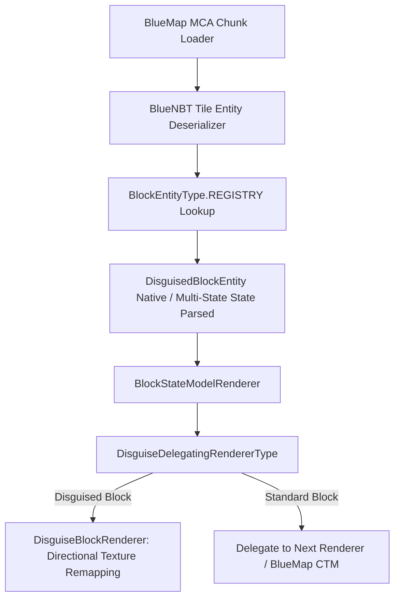

<div align="center">

# BlueMap Disguise & Camouflage

**Server-side dynamic disguise and camouflage renderer for [BlueMap](https://github.com/BlueMap-Minecraft/BlueMap).**

[](https://www.minecraft.net/)
[](https://neoforged.net/)
[](https://adoptium.net/)
[](LICENSE)

</div>

---

## Overview

In modern Minecraft, camouflage and disguise blocks allow players to hide functional blocks (chutes, cables, steps, doors, walls) behind cosmetic materials. However, in Minecraft's world save files (`.mca`), the blockstate palette only stores the generic untextured frame (e.g. `create:copycat_panel` or `copycats:copycat_board`). The actual chosen disguise is stored inside chunk tile entity NBT data.

Standard **BlueMap** reads only static blockstates during chunk tile generation and ignores modded block entity NBT, causing disguised blocks to render as invisible holes, empty wooden frames, or missing textures.

**BlueMap Disguise** solves this by hooking into BlueMap's chunk loading and block rendering pipelines, dynamically reading MCA tile entity NBT and texturing the block elements with the player's chosen material.

---

## Supported Mods & Disguises

1. **Create (`create`)**
   - Blocks: `create:copycat_step`, `create:copycat_panel`
   - Block Entity: `create:copycat`
   - Material extracted from NBT `"material"` tag.
2. **Copycats+ (`copycats`)**
   - Blocks: `copycats:copycat_slab`, `copycats:copycat_stairs`, `copycats:copycat_beam`, `copycats:copycat_block`, `copycats:copycat_fence`, `copycats:copycat_wall`, `copycats:copycat_half_panel`, `copycats:copycat_vertical_slice`, `copycats:copycat_board`, `copycats:copycat_byte`, `copycats:copycat_layer`, `copycats:copycat_folding_door`, etc.
   - Block Entities: 
     - `copycats:copycat` (single material)
     - `copycats:multistate_copycat` (per-face multi-material mapping for `up`, `down`, `north`, `south`, `east`, `west`).
3. **Simple Copycats (`sim_copycats`)**
   - Blocks: `sim_copycats:absurdly_heavy_copycat`, `sim_copycats:bouncy_copycat`, `sim_copycats:glowing_copycat`, slabs, and stairs.
   - Block Entity: `sim_copycats:copycat`.
4. **Tom's Simple Storage Mod (`toms_storage`)**
   - Blocks: `toms_storage:inventory_cable_framed`, `toms_storage:inventory_cable_connector_framed`, `toms_storage:painted_trim`.
   - Block Entity: `toms_storage:painted`.
   - Material extracted from NBT `"block"` tag.

---

## Architecture & Integration



- **Seamless CTM Integration:** Works hand-in-hand with [**BlueMap CTM**](https://github.com/TheAndromedaCat/bluemap-ctm). When a copycat block is disguised as a connecting texture block (e.g. Rechiseled tiles), BlueMap Disguise exposes the disguised blockstate to BlueMap CTM so neighboring blocks connect seamlessly.

---

## Installation

1. Copy `bluemap_disguise-0.1.0.jar` into your server's `mods/` directory.
2. Restart your server. BlueMap Disguise automatically registers its MCA block entity deserializers and wraps the `DEFAULT` renderer upon boot.

---

## Building

```bash
./gradlew build -x test
```
The output jar will be in `build/libs/bluemap_disguise-0.1.0.jar`.

---

## License
MIT
